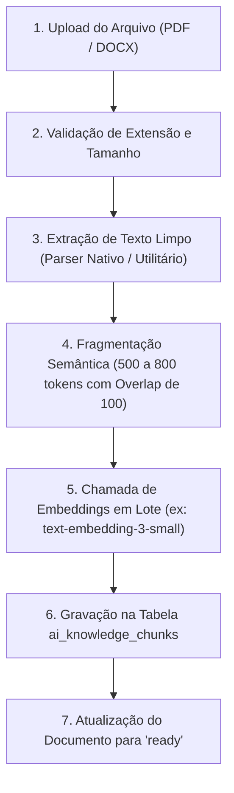

# 🚀 Arquitetura e Roteiro de IA Institucional (RAG & Copilot Pedagógico SENAI)
> **Documento Estratégico e Técnico de Especificação**  
> **Status:** Pronto para Implementação Sob Demanda  
> **Objetivo:** Transformar o iaS em uma plataforma de IA de Alta Performance baseada nas diretrizes, matrizes SAEP e metodologias oficiais do SENAI através de RAG (*Retrieval-Augmented Generation*).

---

## 🎯 1. Visão Geral e Filosofia

Atualmente, o iaS possui integrações pontuais com modelos de linguagem (chamadas diretas com dados estatísticos resumidos injetados no prompt). 

Este plano estabelece a evolução definitiva para um **Ecossistema Institucional de IA RAG**, onde:
1. **Zero Alucinação:** A IA é proibida de inferir ou supor regras fora dos documentos institucionais homologados.
2. **Citação de Fontes:** Toda recomendação, plano ou análise referencia a norma, manual ou página de onde a informação foi extraída.
3. **Independência da T.I.:** Coordenadores e administradores pedagógicos (sem conhecimento de programação) têm controle total para alimentar, atualizar, ativar ou desativar documentos normativos através de uma interface visual amigável.
4. **Alinhamento SAEP/SENAI:** Questões, diagnósticos e planos de aula refletem com 100% de precisão as capacidades técnicas, conhecimentos e critérios da Metodologia SENAI de Educação Profissional.

---

## 🏛️ 2. Arquitetura da Base de Conhecimento (Alimentador de IA)

O **Alimentador de IA** (`admin_ai_knowledge.php`) será a central administrativa onde os gestores sobem e organizam os arquivos institucionais.

### 2.1 Tipos de Arquivos Suportados
* **PDF** (Planos de Curso, Manuais Metodológicos, Apostilas, Diretrizes SAEP);
* **DOCX** (Minutas de planos de aula, regulamentos e roteiros de oficina);
* **TXT / Markdown / CSV** (Tabelas de competências e dados tabulares);
* **Entrada Direta de Texto** (Para comunicados rápidos ou diretrizes pontuais).

### 2.2 Taxonomia e Categorização (Metadados Estratégicos)
Ao fazer upload de um documento, o usuário não-programador preenche apenas 3 ou 4 campos intuitivos:

| Campo | Opções / Exemplo | Objetivo no RAG |
| :--- | :--- | :--- |
| **Tipo de Documento (`document_type`)** | `metodologia_geral`, `criterios_saep`, `plano_curso`, `apostila_tecnica` | Permite que a IA filtre **apenas os trechos relevantes** conforme a ferramenta em uso. |
| **Vínculo de Curso (`course_id`)** | *Global (Todos os Cursos)* ou curso específico (ex: *Téc. em Eletrotécnica*) | Impede que regras curriculares de Mecânica se misturem com as de TI. |
| **Título Amigável** | Ex: *"Guia de Elaboração de Itens SAEP 2026"* | Facilita a identificação e a citação da fonte pela IA. |
| **Versão / Ano** | Ex: `2026.1` | Gestão de ciclo de vida e substituição de materiais legados. |
| **Status** | `Ativo`, `Em Processamento`, `Desativado` | Permite desligar um documento antigo com 1 clique sem apagá-lo. |

---

## 🗄️ 3. Modelagem de Dados no MySQL

Estrutura de tabelas para suportar o armazenamento de documentos, fragmentação semântica e auditoria:

### 3.1 Tabela `ai_knowledge_documents` (Metadados dos Documentos)
```sql
CREATE TABLE IF NOT EXISTS ai_knowledge_documents (
    id INT AUTO_INCREMENT PRIMARY KEY,
    title VARCHAR(255) NOT NULL,
    original_filename VARCHAR(255) NOT NULL,
    file_path VARCHAR(500) NOT NULL,
    file_type VARCHAR(50) NOT NULL, -- pdf, docx, txt
    file_size INT NOT NULL,
    document_type ENUM('metodologia_geral', 'criterios_saep', 'plano_curso', 'apostila_tecnica') NOT NULL,
    course_id INT NULL, -- NULL = Global institucional
    version VARCHAR(50) DEFAULT '1.0',
    total_chunks INT DEFAULT 0,
    status ENUM('processing', 'ready', 'error', 'disabled') DEFAULT 'processing',
    error_message TEXT NULL,
    created_by INT NOT NULL,
    created_at DATETIME DEFAULT CURRENT_TIMESTAMP,
    updated_at DATETIME DEFAULT CURRENT_TIMESTAMP ON UPDATE CURRENT_TIMESTAMP,
    FOREIGN KEY (course_id) REFERENCES courses(id) ON DELETE SET NULL,
    FOREIGN KEY (created_by) REFERENCES users(id) ON DELETE CASCADE
) ENGINE=InnoDB DEFAULT CHARSET=utf8mb4 COLLATE=utf8mb4_unicode_ci;
```

### 3.2 Tabela `ai_knowledge_chunks` (Fragmentos Vetorizados / Texto Indexado)
```sql
CREATE TABLE IF NOT EXISTS ai_knowledge_chunks (
    id INT AUTO_INCREMENT PRIMARY KEY,
    document_id INT NOT NULL,
    chunk_index INT NOT NULL,
    content MEDIUMTEXT NOT NULL,
    token_count INT NOT NULL,
    page_number INT NULL, -- Página de onde o fragmento foi extraído (para citação)
    embedding_json MEDIUMTEXT NULL, -- Vetor de float serializado em JSON (ex: 1536 dimensões)
    metadata_json JSON NULL, -- Tags auxiliares (ex: modulo, capacidade, capitulo)
    created_at DATETIME DEFAULT CURRENT_TIMESTAMP,
    FOREIGN KEY (document_id) REFERENCES ai_knowledge_documents(id) ON DELETE CASCADE,
    FULLTEXT KEY ft_content (content)
) ENGINE=InnoDB DEFAULT CHARSET=utf8mb4 COLLATE=utf8mb4_unicode_ci;
```

### 3.3 Tabela `ai_generation_logs` (Telemetria, Governança e Custos)
```sql
CREATE TABLE IF NOT EXISTS ai_generation_logs (
    id INT AUTO_INCREMENT PRIMARY KEY,
    user_id INT NOT NULL,
    feature_type ENUM('question_generate', 'exam_audit', 'tutor_student', 'distractor_analysis', 'lesson_plan', 'copilot_chat') NOT NULL,
    model_used VARCHAR(50) NOT NULL,
    prompt_tokens INT DEFAULT 0,
    completion_tokens INT DEFAULT 0,
    total_tokens INT DEFAULT 0,
    estimated_cost_usd DECIMAL(10, 6) DEFAULT 0.000000,
    latency_ms INT DEFAULT 0,
    context_chunks_used JSON NULL,
    created_at DATETIME DEFAULT CURRENT_TIMESTAMP,
    FOREIGN KEY (user_id) REFERENCES users(id) ON DELETE CASCADE
) ENGINE=InnoDB DEFAULT CHARSET=utf8mb4 COLLATE=utf8mb4_unicode_ci;
```

---

## ⚙️ 4. Pipeline de Ingestão de Documentos (Backend)

O fluxo de processamento ao enviar um documento ocorre em segundo plano (ou via AJAX com barra de progresso visual):



### 4.1 Estratégia de Fragmentação (Chunking)
* **Tamanho Ideal:** ~600 tokens por fragmento.
* **Sobreposição (Overlap):** ~100 tokens entre fragmentos subsequentes. Isso garante que frases com capacidades ou fórmulas não sejam cortadas pela metade.
* **Metadados embutidos em cada Chunk:** Todo fragmento herda o `document_id`, `page_number` e as tags do documento mãe.

### 4.2 Modelo de Embeddings Recomendado
* **OpenAI `text-embedding-3-small`**:
  * Altíssimo desempenho semântico;
  * Custo irrisório: **$0.02 por milhão de tokens** (cerca de 10 centavos de real para indexar dezenas de apostilas inteiras).
* **Gemini `text-embedding-004`**: Alternativa igualmente veloz e econômica.

---

## 🔍 5. Mecanismo de Busca Híbrida (Hybrid Retrieval)

Como o sistema roda em PHP e MySQL (sem necessidade de banco vetorial externo complexo), a recuperação opera de forma híbrida e ultrarrápida:

1. **Filtro Rígido:** `document_id IN (documentos ativos do curso X ou globais) AND document_type = :target_type`.
2. **Cálculo de Similaridade de Cosseno (Cosine Similarity):**
   * Função otimizada em PHP (`includes/ai_embeddings.php`) que calcula a distância entre o vetor da pergunta do usuário e os vetores armazenados em `embedding_json`.
   * Alternativamente, pré-filtro usando o índice `FULLTEXT (content)` do MySQL para selecionar os 30 melhores candidatos e refinar via Cosseno em memória.
3. **Top-K Chunks:** O sistema seleciona os **3 a 5 fragmentos mais relevantes** (com pontuação de relevância > 0.70).
4. **Injeção de Contexto Blindada:** Os trechos são incorporados ao prompt do sistema com delimitação clara para evitar injeção de prompt e alucinação.

---

## 🛠️ 6. As 4 Aplicações Práticas (Consumo do Core)

### 6.1 Módulo 1: Gerador de Questões no Padrão SAEP (`questions_ai_generate.php`)
* **Interface:** Dropdowns para selecionar Curso, Módulo, Capacidade Cadastrada e Nível de Dificuldade (Básico, Intermediário, Avançado).
* **Contexto RAG injetado:**
  * Fragmentos do *Guia de Elaboração de Itens SAEP*;
  * Fragmentos do *Plano de Curso* que definem os conhecimentos da capacidade selecionada.
* **Instrução Rígida:**
  * OBRIGATÓRIO: Estruturar em Texto-base contextualizado, Situação-Problema prática e Comando claro.
  * OBRIGATÓRIO: 4 ou 5 alternativas. Os distratores devem representar erros conceituais recorrentes previstos na metodologia, nunca respostas absurdas ou óbvias.
  * OBRIGATÓRIO: Justificativa detalhada do gabarito.
* **Ação do Usuário:** Botão *"Aprovar e Salvar no Banco de Questões"* (insere diretamente em `questions` e `question_options`).

### 6.2 Módulo 2: Auditor de Provas e Itens (`sprint_ai_audit.php`)
* **Uso:** Na tela de montagem de prova (`sprint_create.php` ou `sprint_manage.php`), o coordenador clica em *"Auditar com IA"*.
* **A IA analisa as questões selecionadas contra as regras oficiais do Guia SAEP:**
  * ❌ *Alerta de Desproporção:* "A alternativa C tem o triplo de extensão das outras, induzindo o aluno ao acerto."
  * ❌ *Alerta de Dupla Negação:* "A questão 4 usa 'não é incorreto afirmar', prática desaconselhada pelo item 4.1 do manual."
  * ❌ *Alerta de Pegadinha:* "O item 8 avalia memorização de código de norma em vez de competência prática."
  * ✅ *Nota de Conformidade:* Dá uma nota de 0 a 100 de alinhamento ao padrão SENAI.

### 6.3 Módulo 3: Diagnóstico Semântico de Distratores (`sprint_ai_analytics.php`)
* **Uso:** Integrado ao relatório da Sprint (`sprint_report.php`).
* **Lógica:** A IA analisa as respostas da turma (`student_answers`), agrupa as alternativas erradas mais assinaladas e consulta a ementa da disciplina.
* **Exemplo de Parecer da IA:**
  > *"71% dos estudantes erraram a Questão 5 assinalando a alternativa C. Pela análise do Plano de Curso, essa opção reflete uma confusão comum entre o disparo por nível de tensão e o disparo por borda de subida em flip-flops. Recomenda-se realizar uma demonstração prática em bancada com osciloscópio antes da próxima avaliação."*

### 6.4 Módulo 4: Tutor Socrático do Aluno (`student_ai_tutor.php`)
* **Uso:** No histórico de sprints do aluno (`student_dashboard.php` ou `sprint_review.php`), ao lado de cada questão errada, o botão *"Compreender meu erro"*.
* **Regra Fundamental:** O tutor **não entrega a resposta**. Ele atua socráticamente:
  > *"Aluno, você marcou a alternativa que calcula a resistência considerando condutores em série. Observe atentamente a ramificação do nó A no diagrama da questão. O que ocorre com a corrente elétrica naquele ponto?"*

---

## 💬 7. Copilot Institucional ("Pergunte às Normas do SENAI")

Uma interface de chat moderna no painel administrativo (`ai_copilot.php`):
* Destinada a Diretores, Coordenadores e Docentes;
* Permite consultas livres sobre qualquer manual ou plano indexado;
* **Citação Obrigatória de Páginas:** Cada resposta encerra com:
  > 📖 **Fonte Oficial:** *Manual de Metodologia SENAI (Seção 3.2, pág. 44)*.

---

## ⚡ 8. Modernização do Modelo de Linguagem e Otimização de Custos

A arquitetura atual utiliza `gpt-3.5-turbo`. A implementação deste plano inclui a atualização imediata para:

| Recurso | Modelo Legado (`gpt-3.5-turbo`) | Modelo Recomendado (`gpt-4o-mini` ou `gemini-1.5-flash`) |
| :--- | :--- | :--- |
| **Custo de Entrada** | ~$0.50 / milhão de tokens | **~$0.15 / milhão de tokens (70% mais econômico)** |
| **Janela de Contexto** | 4.096 ou 16.384 tokens | **128.000 tokens (permite injetar apostilas inteiras se necessário)** |
| **Raciocínio Lógico** | Básico, propenso a deslizes | **Avançado, alinhado a benchmarks profissionais** |
| **Suporte Multimodal** | Não lê imagens | **Lê esquemas elétricos, diagramas e gráficos nativamente** |

---

## 📋 9. Plano de Implementação Passo a Passo (Fases)

Quando você der a ordem para iniciar o desenvolvimento, executaremos nesta exata sequência estruturada:

### Fase 1: Fundação do Banco de Dados & Central de Upload
* [ ] Executar script de migração `migrate_ai_knowledge.php` criando as tabelas `ai_knowledge_documents`, `ai_knowledge_chunks` e `ai_generation_logs`.
* [ ] Criar a interface administrativa `admin_ai_knowledge.php` com visual TailwindCSS, área de drag & drop e listagem com status dos documentos.

### Fase 2: Parser e Motor de Embeddings
* [ ] Criar classe / helper `includes/ai_parser.php` para extrair texto de arquivos PDF, DOCX e TXT.
* [ ] Criar helper `includes/ai_embeddings.php` para segmentação de chunks e chamadas de vetorização com a API.
* [ ] Implementar processamento com barra de progresso visual.

### Fase 3: Camada de Busca Semântica (RAG Engine)
* [ ] Desenvolver a função `retrieve_relevant_chunks($query, $document_type, $course_id, $limit = 4)`.
* [ ] Implementar filtro de similaridade de cosseno com ranking ponderado.

### Fase 4: Ferramentas Práticas de Consumo
* [ ] **Gerador de Itens SAEP:** Integrar à interface de cadastro de questões (`questions_view.php`).
* [ ] **Auditor de Provas:** Integrar à gestão de Sprints (`sprints.php` / `sprint_manage.php`).
* [ ] **Análise de Distratores:** Integrar ao relatório analítico (`sprint_report.php`).
* [ ] **Tutor Socrático:** Integrar à tela do estudante pós-entrega.

### Fase 5: Copilot Institucional & Telemetria
* [ ] Desenvolver o chat de consulta de normas `ai_copilot.php` com citação de fontes.
* [ ] Dashboard executivo de consumo de tokens e custos estimados por unidade escolar.

---

> **Instrução para a IA ao retomar este projeto:**  
> *"Leia este arquivo PróximosPassos.md na íntegra. Siga estritamente as modelagens de dados, taxonomias e regras de negócio aqui estabelecidas sem alterar o escopo ou simplificar indevidamente a arquitetura."*
