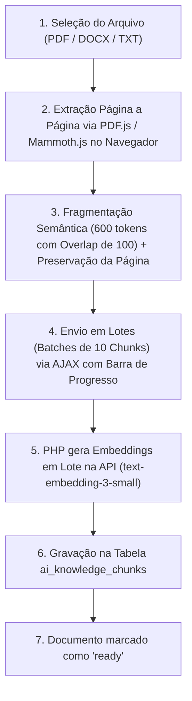

# 🚀 Arquitetura e Roteiro de IA Institucional (RAG & Copilot Pedagógico SENAI)
> **Documento Estratégico e Técnico de Especificação (v2.0 — Revisado & Otimizado para Produção)**  
> **Autoria:** Alceu Matteucci Junior & Equipe Pedagógica do SENAI Luzerna  
> **Status:** Pronto para Implementação Sob Demanda  
> **Objetivo:** Transformar o iaS em uma plataforma de IA de Alta Performance baseada nas diretrizes, matrizes SAEP e metodologias oficiais do SENAI através de RAG (*Retrieval-Augmented Generation*).

---

## 🎯 1. Visão Geral e Filosofia

Atualmente, o iaS possui integrações pontuais com modelos de linguagem (chamadas diretas com dados estatísticos resumidos injetados no prompt). 

Este plano estabelece a evolução definitiva para um **Ecossistema Institucional de IA RAG**, onde:
1. **Zero Alucinação:** A IA é proibida de inferir ou supor regras fora dos documentos institucionais homologados.
2. **Citação de Fontes:** Toda recomendação, plano ou análise referencia a norma, manual, seção e **página exata** de onde a informação foi extraída.
3. **Independência da T.I.:** Coordenadores e administradores pedagógicos (sem conhecimento de programação) têm controle total para alimentar, atualizar, ativar ou desativar documentos normativos através de uma interface visual amigável.
4. **Alinhamento SAEP/SENAI:** Questões, diagnósticos e planos de aula refletem com 100% de precisão as capacidades técnicas, conhecimentos e critérios da Metodologia SENAI de Educação Profissional.
5. **Conformidade LGPD (Anonimização):** Nenhum dado pessoal sensível (nome completo, e-mail ou matrícula de alunos) é enviado às APIs externas; apenas identificadores anônimos e métricas pedagógicas agregadas trafegam nos prompts.

---

## 🏛️ 2. Arquitetura da Base de Conhecimento (Alimentador de IA)

O **Alimentador de IA** (`admin_ai_knowledge.php`) será a central administrativa onde os gestores sobem e organizam os arquivos institucionais.

### 2.1 Tipos de Arquivos Suportados
* **PDF** (Planos de Curso, Manuais Metodológicos, Apostilas, Diretrizes SAEP);
* **DOCX** (Minutas de planos de aula, regulamentos e roteiros de oficina);
* **TXT / Markdown / CSV** (Tabelas de competências e dados tabulares);
* **Entrada Direta de Texto** (Para comunicados rápidos ou diretrizes pontuais).

### 2.2 Taxonomia e Categorização (Metadados Estratégicos)
Ao fazer upload de um documento, o usuário não-programador preenche apenas campos intuitivos:

| Campo | Opções / Exemplo | Objetivo no RAG |
| :--- | :--- | :--- |
| **Tipo de Documento (`document_type`)** | `metodologia_geral`, `criterios_saep`, `plano_curso`, `apostila_tecnica` | Permite que a IA filtre **apenas os trechos relevantes** conforme a ferramenta em uso. |
| **Vínculo de Curso (`course_id`)** | *Global (Todos os Cursos)* ou curso específico (ex: *Téc. em Eletrotécnica*) | Impede que regras curriculares de Mecânica se misturem com as de TI. |
| **Vínculo de Módulo (`module_id`)** | *Todos os Módulos* ou UC específica (opcional) | Refina buscas para apostilas de uma Unidade Curricular específica. |
| **Título Amigável** | Ex: *"Guia de Elaboração de Itens SAEP 2026"* | Facilita a identificação e a citação da fonte pela IA. |
| **Versão / Ano** | Ex: `2026.1` | Gestão de ciclo de vida e substituição de materiais legados. |
| **Status** | `Ativo`, `Em Processamento`, `Desativado` | Permite desligar um documento antigo com 1 clique sem apagá-lo. |

### 2.3 Bônus: Auto-Cadastro Curricular a partir do Plano de Curso
* Quando o administrador fizer upload de um **Plano de Curso (`plano_curso`)**, o sistema oferecerá o botão: **"Extrair Unidades Curriculares e Capacidades Automaticamente"**.
* A IA lerá a matriz curricular do PDF e apresentará uma prévia das Unidades Curriculares (`modules`) e Capacidades Técnicas/Básicas (`capacities`) para cadastrá-las no banco com 1 clique, eliminando horas de digitação manual.

---

## 🗄️ 3. Modelagem de Dados no MySQL

Estrutura de tabelas para suportar o armazenamento de documentos, fragmentação semântica, cache e auditoria:

### 3.1 Tabela `ai_knowledge_documents` (Metadados dos Documentos)
```sql
CREATE TABLE IF NOT EXISTS ai_knowledge_documents (
    id INT AUTO_INCREMENT PRIMARY KEY,
    title VARCHAR(255) NOT NULL,
    original_filename VARCHAR(255) NOT NULL,
    file_path VARCHAR(500) NOT NULL,
    file_type VARCHAR(50) NOT NULL, -- pdf, docx, txt
    file_size INT NOT NULL,
    document_type ENUM('metodologia_geral', 'criterios_saep', 'plano_curso', 'apostila_tecnica') NOT NULL,
    course_id INT NULL, -- NULL = Global institucional
    module_id INT NULL, -- NULL = Todos os módulos do curso
    version VARCHAR(50) DEFAULT '1.0',
    total_chunks INT DEFAULT 0,
    status ENUM('processing', 'ready', 'error', 'disabled') DEFAULT 'processing',
    error_message TEXT NULL,
    created_by INT NOT NULL,
    created_at DATETIME DEFAULT CURRENT_TIMESTAMP,
    updated_at DATETIME DEFAULT CURRENT_TIMESTAMP ON UPDATE CURRENT_TIMESTAMP,
    FOREIGN KEY (course_id) REFERENCES courses(id) ON DELETE SET NULL,
    FOREIGN KEY (module_id) REFERENCES modules(id) ON DELETE SET NULL,
    FOREIGN KEY (created_by) REFERENCES users(id) ON DELETE CASCADE
) ENGINE=InnoDB DEFAULT CHARSET=utf8mb4 COLLATE=utf8mb4_unicode_ci;
```

### 3.2 Tabela `ai_knowledge_chunks` (Fragmentos Vetorizados / Texto Indexado)
```sql
CREATE TABLE IF NOT EXISTS ai_knowledge_chunks (
    id INT AUTO_INCREMENT PRIMARY KEY,
    document_id INT NOT NULL,
    chunk_index INT NOT NULL,
    content MEDIUMTEXT NOT NULL,
    token_count INT NOT NULL,
    page_number INT NULL, -- Página exata de onde o fragmento foi extraído (para citação)
    embedding_json MEDIUMTEXT NULL, -- Vetor de float serializado em JSON (ex: 1536 dimensões)
    metadata_json JSON NULL, -- Tags auxiliares (ex: modulo, capacidade, capitulo)
    created_at DATETIME DEFAULT CURRENT_TIMESTAMP,
    FOREIGN KEY (document_id) REFERENCES ai_knowledge_documents(id) ON DELETE CASCADE,
    FULLTEXT KEY ft_content (content)
) ENGINE=InnoDB DEFAULT CHARSET=utf8mb4 COLLATE=utf8mb4_unicode_ci;
```

### 3.3 Tabela `ai_response_cache` (Cache Inteligente para Economia de Custos)
> **Por que esta tabela é fundamental?** Se 35 alunos de uma turma errarem a mesma questão marcando a alternativa B e clicarem em *"Compreender meu erro"*, o sistema gera a explicação socrática na 1ª vez e responde instantaneamente (a custo zero) para os outros 34 alunos!
```sql
CREATE TABLE IF NOT EXISTS ai_response_cache (
    id INT AUTO_INCREMENT PRIMARY KEY,
    cache_key VARCHAR(128) NOT NULL UNIQUE, -- SHA-256 de (feature_type + target_id + params)
    feature_type VARCHAR(50) NOT NULL,
    response_payload LONGTEXT NOT NULL,
    hits INT DEFAULT 1,
    created_at DATETIME DEFAULT CURRENT_TIMESTAMP,
    expires_at DATETIME NULL
) ENGINE=InnoDB DEFAULT CHARSET=utf8mb4 COLLATE=utf8mb4_unicode_ci;
```

### 3.4 Tabela `ai_generation_logs` (Telemetria, Governança e Custos)
```sql
CREATE TABLE IF NOT EXISTS ai_generation_logs (
    id INT AUTO_INCREMENT PRIMARY KEY,
    user_id INT NOT NULL,
    feature_type ENUM('question_generate', 'exam_audit', 'tutor_student', 'distractor_analysis', 'lesson_plan', 'copilot_chat', 'curriculum_extract') NOT NULL,
    model_used VARCHAR(50) NOT NULL,
    prompt_tokens INT DEFAULT 0,
    completion_tokens INT DEFAULT 0,
    total_tokens INT DEFAULT 0,
    estimated_cost_usd DECIMAL(10, 6) DEFAULT 0.000000,
    latency_ms INT DEFAULT 0,
    context_chunks_used JSON NULL,
    created_at DATETIME DEFAULT CURRENT_TIMESTAMP,
    FOREIGN KEY (user_id) REFERENCES users(id) ON DELETE CASCADE
) ENGINE=InnoDB DEFAULT CHARSET=utf8mb4 COLLATE=utf8mb4_unicode_ci;
```

---

## ⚙️ 4. Pipeline Híbrido de Ingestão de Documentos (Compatível 100% com cPanel)

> **Desafio de Hospedagem Compartilhada (cPanel):** Servidores compartilhados frequentemente bloqueiam binários Linux como `pdftotext` ou estouram `max_execution_time` ao processar PDFs de 200 páginas no PHP.  
> **Solução Arquitetural Híbrida:** Extração assistida no cliente (*Client-Side Parsing*) + Processamento em lotes (*Chunk Batching*) via AJAX.



### 4.1 Vantagens dessa Engenharia
* **Zero dependência de extensões externas no servidor:** Funciona em qualquer cPanel padrão.
* **Zero Timeout:** Apostilas de 300 páginas são processadas em lotes de 10 fragmentos com barra de progresso em tempo real (`Processando página 45 de 180...`).
* **Preservação Exata da Página (`page_number`):** O `PDF.js` sabe exatamente em qual página cada parágrafo está, permitindo citações perfeitas (`Página 42`).

---

## 🔍 5. Mecanismo de Busca Híbrida (Hybrid Retrieval)

Como o sistema roda em PHP e MySQL (sem necessidade de banco vetorial pago externo), a recuperação opera em duas etapas ultrarrápidas:

1. **Filtro Rígido SQL:** Filtra `ai_knowledge_documents` ativos do `course_id` atual (ou globais) e do `document_type` exigido pela ferramenta.
2. **Scoring Híbrido (BM25 Full-Text + Cosine Similarity Vetorial):**
   * Calcula a similaridade de cosseno em memória no PHP entre o vetor da consulta e os vetores dos chunks candidatos (`dot_product(A, B)`), combinada com o score lexical de palavras-chave técnicas (siglas de normas como `NR-10`, `NBR 5410`, códigos de capacidades).
3. **Top-K Chunks:** Seleciona os **4 fragmentos mais relevantes** (score > 0.70).
4. **Injeção de Contexto Blindada:** Os trechos são injetados no prompt com tags XML estruturadas (`<documento titulo="..." pagina="...">...</documento>`).

---

## 🛠️ 6. As 4 Aplicações Práticas (Consumo do Core)

### 6.1 Módulo 1: Gerador de Questões no Padrão SAEP (`questions_ai_generate.php`)
* **Interface:** Dropdowns para Curso, Módulo, Capacidade Cadastrada, Dificuldade e Contexto Industrial desejado.
* **Contexto RAG injetado:** Fragmentos do *Guia de Elaboração de Itens SAEP* + *Plano de Curso*.
* **Saída Estruturada (`JSON Schema` estrito):**
  * `base_text`: Texto-base contextualizado com situação real da indústria;
  * `problem_statement`: Situação-problema e comando claro da questão;
  * `options`: 4 ou 5 alternativas, cada uma contendo `text`, `is_correct` e `distractor_rationale` (explicação técnica de qual erro conceitual aquele distrator representa);
  * `normative_reference`: Fonte do Plano de Curso utilizada.
* **Ação do Usuário:** Botão *"Aprovar e Salvar no Banco de Questões"* com 1 clique.

### 6.2 Módulo 2: Auditor de Provas e Itens (`sprint_ai_audit.php`)
* **Uso:** Na tela de gestão de prova, o professor/coordenador clica em *"Auditar Qualidade SAEP"*.
* **Análise Automatizada contra o Guia Oficial:**
  * ❌ *Alerta de Extensão:* "A alternativa correta é significativamente mais longa e detalhada que os distratores."
  * ❌ *Alerta de Comando Negativo:* "Uso de 'EXCETO' ou 'INCORRETO' sem destaque ou fora da recomendação metodológica."
  * ❌ *Alerta de Nível Taxonômico:* "A capacidade exige 'Aplicar/Dimensionar', mas a questão cobra apenas 'Lembrar/Definir'."
  * ✅ *Score de Qualidade SAEP:* Nota de 0 a 100 com sugestões de reescrita automática em 1 clique.

### 6.3 Módulo 3: Diagnóstico Semântico de Distratores (`sprint_ai_analytics.php`)
* **Uso:** Integrado ao relatório da Sprint (`sprint_report.php`).
* **Lógica:** A IA recebe a matriz de distribuição de respostas por alternativa (`A: 12%, B: 68% [errada], C: 15% [correta], D: 5%`) e cruza com o Plano de Curso.
* **Resultado:** Parecer executivo explicando a **causa-raiz cognitiva** do erro coletivo da turma e propondo uma atividade prática de oficina específica para corrigir aquele vício conceitual.

### 6.4 Módulo 4: Tutor Socrático do Aluno (`student_ai_tutor.php`)
* **Uso:** Na revisão de prova do estudante, botão *"Compreender meu erro com IA"*.
* **Metodologia Socrática:** Nunca entrega o gabarito direto. Faz uma pergunta orientadora baseada no erro específico da alternativa que o aluno marcou e na teoria da apostila do SENAI (incluindo leitura multimodal caso a questão possua imagem de circuito/diagrama).

---

## 💬 7. Copilot Institucional ("Pergunte às Normas do SENAI")

Interface de chat no painel administrativo/docente (`ai_copilot.php`):
* Consultas livres sobre metodologias, planos de curso e diretrizes;
* **Citação Obrigatória com Fonte e Página:**
  > 📖 **Referência:** *Manual de Metodologia SENAI (Página 44)*.

---

## ⚡ 8. Modernização do Modelo de Linguagem e Custos

Substituição do legado `gpt-3.5-turbo` por **`gpt-4o-mini`** (ou **`gemini-1.5-flash`**):
* **Economia de ~70%** por token processado;
* **Suporte Multimodal Nativo:** Capacidade de enxergar e interpretar as imagens de apoio (diagramas, circuitos, gráficos) recém-implementadas nas questões do iaS;
* **Suporte a `response_format: json_schema`:** Garantia de que integrações de sistema nunca quebrem por falha de formatação.

---

## 📋 9. Plano de Implementação Passo a Passo (Fases)

Quando você autorizar o início do desenvolvimento, seguiremos esta ordem:

### Fase 1: Fundação do Banco de Dados & Alimentador de IA
* [ ] Criar script `migrate_ai_knowledge.php` (`ai_knowledge_documents`, `ai_knowledge_chunks`, `ai_response_cache`, `ai_generation_logs`).
* [ ] Criar a tela `admin_ai_knowledge.php` com upload Drag & Drop, categorização por curso/tipo e barra de progresso em lotes.

### Fase 2: Extrator Híbrido e Motor de Embeddings
* [ ] Integrar extração página a página (PDF.js / Mammoth.js + fallback PHP) e chunking com overlap.
* [ ] Criar `includes/ai_rag_engine.php` para geração de embeddings (`text-embedding-3-small`), busca híbrida por similaridade de cosseno e cache semântico.

### Fase 3: Ferramentas Práticas para Docentes e Coordenadores
* [ ] **Gerador de Questões SAEP** integrado ao Banco de Questões (`questions.php`) + Auto-extrator de Capacidades de Planos de Curso.
* [ ] **Auditor de Provas SAEP** e **Diagnóstico Semântico de Distratores** integrados aos relatórios de Sprints (`sprint_report.php`).

### Fase 4: Experiência do Aluno & Copilot Institucional
* [ ] **Tutor Socrático Multimodal** integrado ao painel do aluno.
* [ ] **Chat Copilot Institucional** (`ai_copilot.php`) com citações de página e painel de telemetria de uso.

---

> **Instrução para a IA ao retomar este projeto:**  
> *"Leia este arquivo PróximosPassos.md na íntegra. Siga estritamente as modelagens de dados, pipeline híbrido para cPanel, cache semântico e regras de negócio aqui estabelecidas."*
